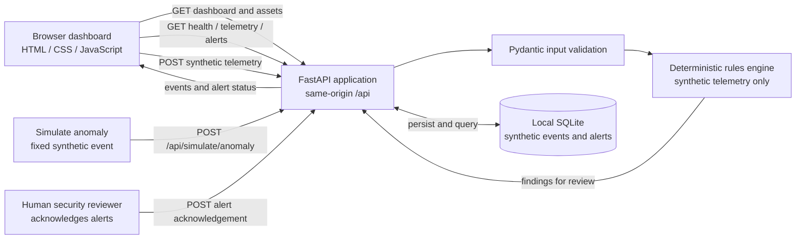

# Architecture diagram

Textual Mermaid specification for the architecture diagram (used instead of a binary PNG so the diagram remains reviewable and version-controlled):

All components run locally. The simulator does not produce network traffic toward devices or third-party systems. The diagram describes a demonstration, not a deployment architecture for a healthcare environment.
